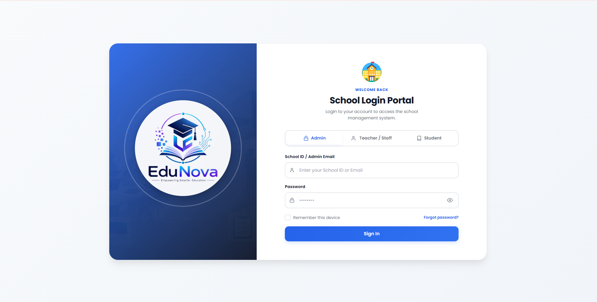
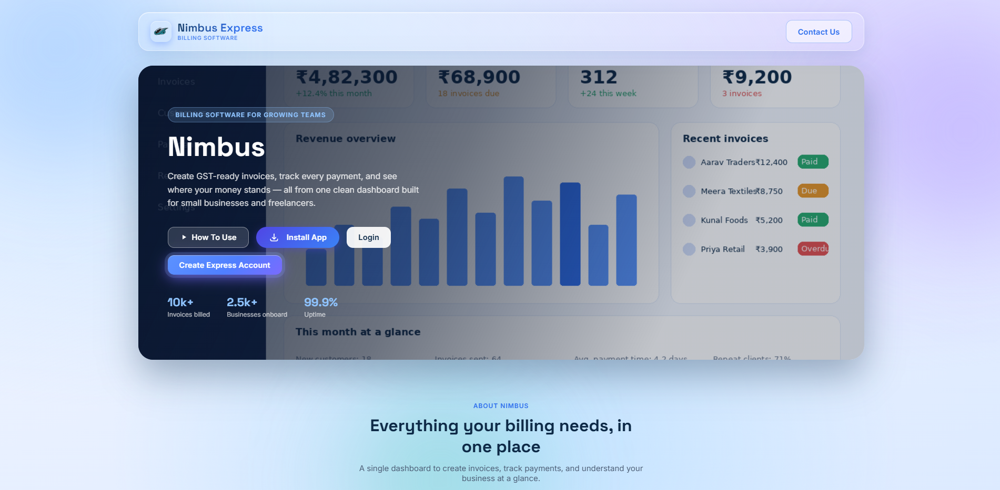

<div align="center">

<!-- CAPSULE / CYBER BANNER HEADER -->


<!-- TYPING ANIMATION (Dynamic Red Cyberpunk Theme) -->
<a href="https://shakshindustries.netlify.app">
  
</a>

<br/>

<!-- ACTION BADGES -->
<p align="center">
  <a href="https://shakshindustries.netlify.app" target="_blank">
    
  </a>
  <a href="mailto:shaksh.coder@gmail.com">
    
  </a>
  <a href="https://wa.me/919936475054" target="_blank">
    
  </a>
</p>

<!-- SOCIAL MATRIX PILLS -->
<p align="center">
  <a href="https://youtube.com/@shakshindustry?feature=shared" target="_blank">
    
  </a>
  &nbsp;
  <a href="https://t.me/programmershaksh" target="_blank">
    
  </a>
  &nbsp;
  <a href="https://www.instagram.com/shaksh.coder" target="_blank">
    
  </a>
  &nbsp;
  <a href="https://linkedin.com/in/shaksh" target="_blank">
    
  </a>
  &nbsp;
  <a href="https://github.com/shakshindustries" target="_blank">
    
  </a>
</p>

<!-- SNAKE SVG / METRICS -->


</div>

<br/>

<!-- ===================================================================== -->
<!-- SECTION: ABOUT & EXECUTIVE IDENTITY -->
<!-- ===================================================================== -->

<table width="100%" border="0" cellspacing="0" cellpadding="0">
  <tr>
    <td width="38%" align="center" valign="middle">
      
      <br/><br/>
      
    </td>
    <td width="62%" valign="top">
      <h2 style="color: #ff2a4b;">⚡ Executive Overview</h2>
      <p>
        Hi! I’m <b>Shaksh</b>, an India-based <b>Full-Stack Developer & Creative Technologist</b> specializing in next-generation liquid-glass UI architectures, GPU-accelerated 3D WebGL experiences with Three.js, and performant Android solutions.
      </p>
      <p>
        📍 <b>Location:</b> Prayagraj, Uttar Pradesh, India<br/>
        🎓 <b>Education:</b> B.C.A (Bachelor of Computer Applications) • <b>8.0 CGPA</b><br/>
        💼 <b>Focus Areas:</b> 3D Interactive WebGL, React Ecosystems, Kotlin Android Apps, High-Impact Media<br/>
        ⚡ <b>Working Hours:</b> Mon — Sat, 9:00 AM — 8:00 PM IST (Replies within 24h)
      </p>
      <p>
        <b>🎨 Design Philosophy:</b> Pure dark contrast (<code>#050507</code> void base), high-refraction frosted glass, precision micro-animations, and vibrant crimson illumination (<code>#ff2a4b</code>).
      </p>
    </td>
  </tr>
</table>

<br/>

<!-- ===================================================================== -->
<!-- SECTION: TECH ARSENAL & KNOWLEDGE MATRIX -->
<!-- ===================================================================== -->

## 🛠️ Technical Stack & Knowledge Mastery

<div align="center">

| Domain | Core Technologies & Frameworks | Proficiency Level |
| :--- | :--- | :---: |
| **Frontend & UI** | `React 19` `Vite` `Next.js` `JavaScript ES2026+` `TypeScript` `HTML5/CSS3` | `95% - Expert` |
| **3D & Shaders** | `Three.js` `WebGL` `GLSL Shaders` `GLTF Loaders` `Physics & HUD` | `90% - Specialist` |
| **Mobile Native** | `Kotlin` `Jetpack Compose` `Material 3` `Coroutines` `Room DB` `MVVM` | `86% - Advanced` |
| **Backend & APIs** | `Node.js` `Express` `Python` `PHP` `RESTful APIs` `GraphQL` | `88% - Advanced` |
| **Data & Storage** | `MySQL` `PostgreSQL` `LocalStorage APIs` `Firebase` | `87% - Proficient` |
| **DevOps & Tools** | `Git` `GitHub CI/CD` `Netlify` `Postman` `Figma` `VS Code` | `92% - Advanced` |

<br/>

### 🎯 Skill Knowledge Breakdown (Synchronized with Portfolio HUD)

```
React.js            [==================================================] 95%
HTML5 & Liquid CSS  [==================================================] 96%
JavaScript ES2026+  [================================================= ] 94%
Git & DevOps        [================================================  ] 92%
Three.js & WebGL    [===============================================   ] 90%
Next.js Framework   [==============================================    ] 89%
Node.js & APIs      [==============================================    ] 88%
TypeScript          [==============================================    ] 88%
Kotlin Android SDK  [=============================================     ] 86%
Python Automation   [============================================      ] 85%
```

</div>

<br/>

<!-- ===================================================================== -->
<!-- SECTION: FEATURED PRODUCTION SHOWCASE -->
<!-- ===================================================================== -->

## 🚀 Featured Production Projects

Each project below is live in production and built with responsive, cross-platform standards:

<table width="100%">
  <tr>
    <td width="50%" valign="top">
      <h3 align="center">🎨 ABCM Web Platform</h3>
      <p align="center">
        <a href="https://abcm.netlify.app" target="_blank">
          
        </a>
      </p>
      <p><b>Category:</b> Full Stack Web Application<br/>
      <b>Stack:</b> <code>React</code> <code>CSS3</code> <code>JavaScript</code> <code>Netlify</code><br/>
      Modern web platform built for seamless user interaction, dynamic workflows, and responsive cross-device compatibility.</p>
      <p align="center">
        <a href="https://abcm.netlify.app" target="_blank">
          
        </a>
      </p>
    </td>
    <td width="50%" valign="top">
      <h3 align="center">🤖 AI Image Creator</h3>
      <p align="center">
        <a href="https://aiimagecreator.netlify.app" target="_blank">
          
        </a>
      </p>
      <p><b>Category:</b> AI & Generative Media<br/>
      <b>Stack:</b> <code>React</code> <code>AI APIs</code> <code>Prompt Engineering</code> <code>Tailwind</code><br/>
      Generative image application transforming prompt ideas into visual art with instant rendering models.</p>
      <p align="center">
        <a href="https://aiimagecreator.netlify.app" target="_blank">
          
        </a>
      </p>
    </td>
  </tr>
  <tr>
    <td width="50%" valign="top">
      <h3 align="center">🎓 Campus One Portal</h3>
      <p align="center">
        <a href="https://campusone.fast-page.org" target="_blank">
          
        </a>
      </p>
      <p><b>Category:</b> Educational Platform<br/>
      <b>Stack:</b> <code>PHP</code> <code>MySQL</code> <code>JavaScript</code> <code>Responsive UI</code><br/>
      Academic management portal organizing student rosters, college notices, and interactive study resources.</p>
      <p align="center">
        <a href="https://campusone.fast-page.org" target="_blank">
          
        </a>
      </p>
    </td>
    <td width="50%" valign="top">
      <h3 align="center">📊 EduNova Manager</h3>
      <p align="center">
        <a href="https://edunovamanger.gt.tc" target="_blank">
          
        </a>
      </p>
      <p><b>Category:</b> Management Dashboard<br/>
      <b>Stack:</b> <code>PHP</code> <code>JavaScript</code> <code>Bootstrap</code> <code>MySQL</code><br/>
      Educational administration dashboard streamlining student attendance tracking, records, and analytics.</p>
      <p align="center">
        <a href="https://edunovamanger.gt.tc" target="_blank">
          
        </a>
      </p>
    </td>
  </tr>
  <tr>
    <td width="50%" valign="top">
      <h3 align="center">🚚 Nimbus Express</h3>
      <p align="center">
        <a href="https://nimbusexpress.free.je" target="_blank">
          
        </a>
      </p>
      <p><b>Category:</b> Logistics & Tracking<br/>
      <b>Stack:</b> <code>JavaScript</code> <code>API Integration</code> <code>CSS3</code> <code>HTML5</code><br/>
      High-speed delivery and logistics tracking application with package status lookup and routing workflows.</p>
      <p align="center">
        <a href="https://nimbusexpress.free.je" target="_blank">
          
        </a>
      </p>
    </td>
    <td width="50%" valign="top">
      <h3 align="center">💳 Shaksh Industries Billing</h3>
      <p align="center">
        <a href="https://shakshindustriesbilling.infinityfree.me" target="_blank">
          
        </a>
      </p>
      <p><b>Category:</b> Enterprise Billing<br/>
      <b>Stack:</b> <code>PHP</code> <code>MySQL</code> <code>Invoice Engine</code> <code>JavaScript</code><br/>
      Enterprise invoice and transaction billing management software with automated receipt generation and tax computation.</p>
      <p align="center">
        <a href="https://shakshindustriesbilling.infinityfree.me" target="_blank">
          
        </a>
      </p>
    </td>
  </tr>
</table>

<br/>

<!-- ===================================================================== -->
<!-- SECTION: ACADEMIC & CERTIFICATIONS -->
<!-- ===================================================================== -->

## 🎓 Academic Foundations & Certifications

```
┌─────────────────────────────────────────────────────────────────────────────┐
│ 01 // 2024 — 2027  [B.C.A - Bachelor of Computer Applications]              │
│       Prof. Rajendra Prasad University Naini, Prayagraj  •  ★ 8.0 CGPA      │
│       Focus: Data Structures, Algorithms, DBMS, Software Engineering        │
├─────────────────────────────────────────────────────────────────────────────┤
│ 02 // 2023 — Present [Advanced Web & 3D Graphics Engineering]               │
│       Professional Specialization & WebGL Deep Dives                        │
│       Focus: Three.js Shaders, GLSL, Liquid Glass Components, Core Web Vitals│
├─────────────────────────────────────────────────────────────────────────────┤
│ 03 // 2023 — 2024  [Android Mobile Application Architecture]                │
│       Google Android Developer Specialization                               │
│       Focus: Kotlin Coroutines, Jetpack Compose, Material 3, MVVM & Room DB │
└─────────────────────────────────────────────────────────────────────────────┘
```

<br/>

<!-- ===================================================================== -->
<!-- SECTION: GITHUB STATS & METRICS -->
<!-- ===================================================================== -->

## 📊 GitHub Analytics & Developer Activity

<div align="center">

<table border="0" cellspacing="0" cellpadding="0">
  <tr>
    <td>
      
    </td>
    <td>
      
    </td>
  </tr>
  <tr>
    <td colspan="2" align="center">
      <br/>
      
    </td>
  </tr>
</table>

</div>

<br/>

<!-- ===================================================================== -->
<!-- SECTION: LOCAL SETUP -->
<!-- ===================================================================== -->

## 💻 Local Development Setup

To run this React 19 + Three.js portfolio locally:

```bash
# 1. Clone the repository
git clone https://github.com/shakshindustries/shaksh-portfolio.git
cd shaksh-portfolio

# 2. Install dependencies
npm install

# 3. Launch Vite development server
npm run dev

# 4. Create production build
npm run build
```

---

<!-- ===================================================================== -->
<!-- SECTION: FOOTER & CONNECT -->
<!-- ===================================================================== -->

<div align="center">

### 🤝 Let's Build Something Extraordinary Together

<p>
  <b>Phone:</b> <a href="tel:+919936475054">+91 9936475054</a> &nbsp;|&nbsp;
  <b>Email:</b> <a href="mailto:shaksh.coder@gmail.com">shaksh.coder@gmail.com</a> &nbsp;|&nbsp;
  <b>WhatsApp:</b> <a href="https://wa.me/919936475054">+91 9936475054</a>
</p>

<!-- FOOTER WAVE -->


<sub>© 2026 Shaksh • Crafted with React 19, Three.js & Liquid Glass Design System</sub>

</div>
