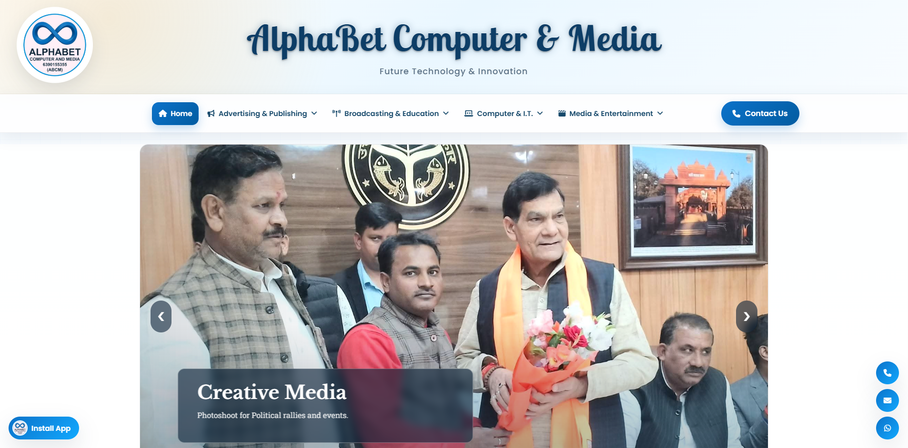
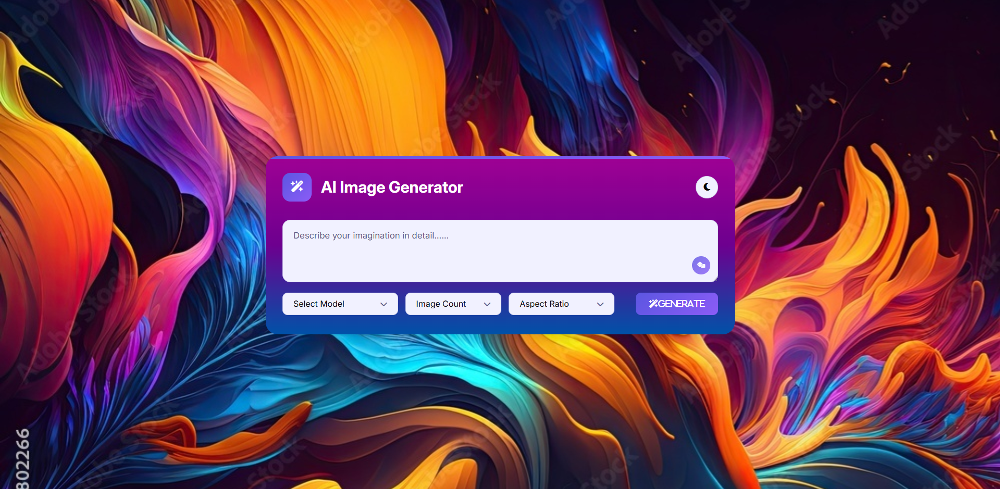
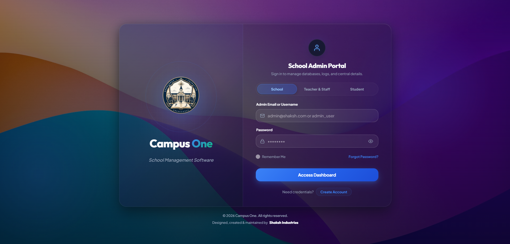
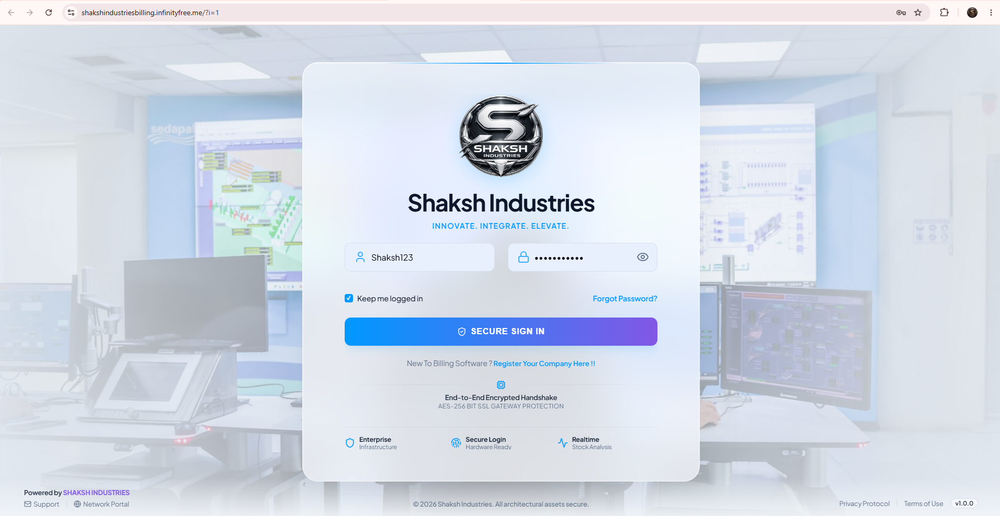

<!-- ========================================================================= -->
<!-- 1. FIXED GLASS NAVBAR SIMULATION (Exact Layout: Brand Left, Menu, Hire Me) -->
<!-- ========================================================================= -->

<table width="100%" bgcolor="#0c0c12" style="background-color: #0c0c12; border: 1px solid rgba(255,42,75,0.35); border-radius: 100px; padding: 10px 24px;">
  <tr>
    <td width="20%" align="left" valign="middle">
      <a href="https://shakshindustries.netlify.app" target="_blank" style="text-decoration: none;">
        <b>SHAKSH</b>
      </a>
    </td>
    <td width="60%" align="center" valign="middle">
      
        &nbsp;&nbsp;
        <a href="#-about--specialization" style="color: #cbd5e1; text-decoration: none;"><b>Home</b></a>
        &nbsp;&nbsp;•&nbsp;&nbsp;
        <a href="#-orbital-skills-showcase" style="color: #cbd5e1; text-decoration: none;"><b>Skills</b></a>
        &nbsp;&nbsp;•&nbsp;&nbsp;
        <a href="#-academic--qualifications" style="color: #cbd5e1; text-decoration: none;"><b>Education</b></a>
        &nbsp;&nbsp;•&nbsp;&nbsp;
        <a href="#-production-showcase" style="color: #cbd5e1; text-decoration: none;"><b>Projects</b></a>
        &nbsp;&nbsp;•&nbsp;&nbsp;
        <a href="#-direct-transmission--contact" style="color: #cbd5e1; text-decoration: none;"><b>Contact</b></a>
        &nbsp;&nbsp;
      
    </td>
    <td width="20%" align="right" valign="middle">
      
    </td>
  </tr>
</table>

 

<!-- ========================================================================= -->
<!-- 2. SCROLLYTELLING HERO TITLE (WEB DEVELOPER // 3D HOLO)                   -->
<!-- ========================================================================= -->

 

<!-- Ambient HUD Status Pill -->

 

<!-- ========================================================================= -->
<!-- 3. HERO STAGE: LEFT CONTENT + CENTER CIRCLE AVATAR + RIGHT FOCUS CARDS     -->
<!-- ========================================================================= -->

<table width="100%" bgcolor="#050507" style="background-color: #050507; border: 1px solid rgba(255,42,75,0.22); border-radius: 24px; padding: 22px;">
  <tr>
    <!-- LEFT COLUMN: ABOUT // SHAKSH -->
    <td width="33%" valign="top" style="padding: 16px;">
      <b>01 // 3D & FRONTEND</b> 
        
      
        <b>Engineering Bold</b> 
        <b>Digital Realities</b>
      
        
      
        Hi, I’m <b>Shaksh</b> — a creative web developer building high-performance, liquid-glass web interfaces with cutting-edge 3D interactive experiences and refined aesthetics.
      
        
      
      &nbsp;
      
    </td>

    <!-- CENTER COLUMN: STRICTLY CIRCULAR AVATAR WITH CRIMSON GLOW -->
    <td width="34%" align="center" valign="middle" style="padding: 16px;">
      <table border="0" cellspacing="0" cellpadding="0">
        <tr>
          <td align="center" style="background: radial-gradient(circle, rgba(255,42,75,0.3) 0%, transparent 70%); border-radius: 50%; padding: 18px;">
            
          </td>
        </tr>
      </table>
       
      <b>SHAKSH // CORE AVATAR</b> 
      HOLO // PORTAL 3D • INTERACTIVE
    </td>

    <!-- RIGHT COLUMN: SPECIALIZATION // FOCUS CARDS -->
    <td width="33%" valign="top" style="padding: 16px;">
      <b>SPECIALIZATION // FOCUS</b>  
      
      <!-- Card 01 -->
      <table width="100%" bgcolor="#0e0e16" style="background-color: #0e0e16; border: 1px solid rgba(255,42,75,0.25); border-radius: 12px; margin-bottom: 8px; padding: 10px;">
        <tr>
          <td width="15%" valign="top"><b>01</b></td>
          <td width="85%" valign="top">
            <b>Frontend & Interactive Web</b> 
            React 19, Liquid Glass UI & Fluid Motion
          </td>
        </tr>
      </table>

      <!-- Card 02 -->
      <table width="100%" bgcolor="#0e0e16" style="background-color: #0e0e16; border: 1px solid rgba(255,42,75,0.25); border-radius: 12px; margin-bottom: 8px; padding: 10px;">
        <tr>
          <td width="15%" valign="top"><b>02</b></td>
          <td width="85%" valign="top">
            <b>Three.js & WebGL Canvases</b> 
            Hologram Meshes, Shaders & 3D HUDs
          </td>
        </tr>
      </table>

      <!-- Card 03 -->
      <table width="100%" bgcolor="#0e0e16" style="background-color: #0e0e16; border: 1px solid rgba(255,42,75,0.25); border-radius: 12px; padding: 10px;">
        <tr>
          <td width="15%" valign="top"><b>03</b></td>
          <td width="85%" valign="top">
            <b>Native Android Engineering</b> 
            Kotlin, Jetpack Compose & Clean MVVM
          </td>
        </tr>
      </table>
    </td>
  </tr>
</table>

 

<!-- ========================================================================= -->
<!-- 4. FLOATING SOCIAL DOCK (Exact 8 Channels from your Hero Bar)              -->
<!-- ========================================================================= -->

  <table bgcolor="#0a0a10" style="background-color: #0a0a10; border: 1px solid rgba(255,42,75,0.3); border-radius: 100px; padding: 6px 18px;">
    <tr>
      <td align="center">
        
        &nbsp;
        
        &nbsp;
        
        &nbsp;
        
        &nbsp;
        
        &nbsp;
        
        &nbsp;
        
        &nbsp;
        
      </td>
    </tr>
  </table>

  

<!-- ========================================================================= -->
<!-- 5. SECTION: SKILLS (Exact Orbital HUD System with Knowledge Meters)       -->
<!-- ========================================================================= -->

  <b>SKILLS</b> 
  

 

<table width="100%" bgcolor="#050507" style="background-color: #050507; border: 1px solid rgba(255,42,75,0.3); border-radius: 20px; padding: 20px;">
  <tr>
    <!-- Left: Planetary Center Podium Image -->
    <td width="35%" align="center" valign="middle" style="padding: 16px;">
      
        
      <b>Shaksh</b> 
      PLANETARY ORBIT SYSTEM
    </td>

    <!-- Right: Knowledge HUD Breakdown with Exact Percentages -->
    <td width="65%" valign="top" style="padding: 16px;">
      
      <!-- React 95% -->
      <table width="100%" border="0">
        <tr>
          <td><b>⚛️ React.js</b> (ADVANCED / SPECIALIST)</td>
          <td align="right"><b>95%</b></td>
        </tr>
      </table>
       
      Component architecture, custom hooks, reactive models, Three.js integration, WebGL performance.
        

      <!-- JavaScript 94% -->
      <table width="100%" border="0">
        <tr>
          <td><b>💛 JavaScript ES2026+</b> (EXPERT LEVEL)</td>
          <td align="right"><b>94%</b></td>
        </tr>
      </table>
       
      Asynchronous event loops, functional programming, DOM performance, memory optimization.
        

      <!-- Three.js 90% -->
      <table width="100%" border="0">
        <tr>
          <td><b>🔺 Three.js & WebGL</b> (SPECIALIST)</td>
          <td align="right"><b>90%</b></td>
        </tr>
      </table>
       
      3D shaders, GLTF model loaders, lighting configurations, camera interpolation, 60fps GPU rendering.
        

      <!-- HTML5 / CSS3 96% -->
      <table width="100%" border="0">
        <tr>
          <td><b>🎨 HTML5 & Liquid CSS3</b> (EXPERT LEVEL)</td>
          <td align="right"><b>96%</b></td>
        </tr>
      </table>
       
      Glassmorphism, backdrop filters, CSS keyframe choreography, responsive container queries.
        

      <!-- Kotlin 86% -->
      <table width="100%" border="0">
        <tr>
          <td><b>📱 Kotlin & Android</b> (ADVANCED)</td>
          <td align="right"><b>86%</b></td>
        </tr>
      </table>
       
      Jetpack Compose declarative UI, coroutines, reactive flows, MVVM architecture, Room database caching.

    </td>
  </tr>
</table>

  

<!-- ========================================================================= -->
<!-- 6. SECTION: EDUCATION & FOUNDATIONS (Exact Milestone Stepper)             -->
<!-- ========================================================================= -->

   
  <b>Education & Foundations</b>

 

<table width="100%" bgcolor="#0e0e16" style="background-color: #0e0e16; border: 1.5px solid rgba(255,42,75,0.35); border-radius: 20px; padding: 22px;">
  <tr>
    <td width="30%" valign="top" style="border-right: 1px solid rgba(255,255,255,0.08); padding-right: 20px;">
      <b>01 // 2024 — 2027</b> 
        
      <b>B.C.A</b> 
      Prof. Rajendra Prasad University Naini, Prayagraj  
      Maintaining an 8.0 CGPA academic track record across core computer science and software architecture curriculum.
    </td>
    <td width="35%" valign="top" style="border-right: 1px solid rgba(255,255,255,0.08); padding: 0 20px;">
      <b>02 // 2023 — Present</b> 
        
      <b>Web & 3D Engineering</b> 
      Three.js, GLSL Shaders & WebGL  
      Intensive deep-dives into Three.js shader programming, GLSL pipelines, responsive liquid-glass component libraries, and sub-second Core Web Vitals.
    </td>
    <td width="35%" valign="top" style="padding-left: 20px;">
      <b>03 // 2023 — 2024</b> 
        
      <b>Android Architecture</b> 
      Google Android Developer Track  
      Mastery of Kotlin Coroutines, Jetpack Compose declarative UI, Material Design 3, Room database caching, and Clean MVVM architecture.
    </td>
  </tr>
</table>

  

<!-- ========================================================================= -->
<!-- 7. SECTION: FEATURED PROJECTS (Exact Browser Mockup Layout)               -->
<!-- ========================================================================= -->

   
  <b>Featured Projects</b>

 

<!-- ROW 1: ABCM Web Platform & AI Image Creator -->
<table width="100%" bgcolor="#050507" style="background-color: #050507; border: 1px solid rgba(255,42,75,0.25); border-radius: 20px; padding: 18px; margin-bottom: 20px;">
  <tr>
    <!-- Project 1 -->
    <td width="50%" valign="top" style="padding: 12px;">
      <!-- Browser Top Bar -->
      <table width="100%" bgcolor="#12121c" style="background-color: #12121c; border-radius: 10px 10px 0 0; padding: 6px 12px; border-bottom: 1px solid rgba(255,255,255,0.08);">
        <tr>
          <td align="left">● ● ●</td>
          <td align="right">🔒 abcm.netlify.app</td>
        </tr>
      </table>
      
       
      FULL STACK WEB APP 
      <b>ABCM Web Platform</b> 
      Modern web platform built for seamless user interaction, dynamic workflows, and responsive cross-device compatibility.  
      
    </td>

    <!-- Project 2 -->
    <td width="50%" valign="top" style="padding: 12px;">
      <!-- Browser Top Bar -->
      <table width="100%" bgcolor="#12121c" style="background-color: #12121c; border-radius: 10px 10px 0 0; padding: 6px 12px; border-bottom: 1px solid rgba(255,255,255,0.08);">
        <tr>
          <td align="left">● ● ●</td>
          <td align="right">🔒 aiimagecreator.netlify.app</td>
        </tr>
      </table>
      
       
      AI & GENERATIVE MEDIA 
      <b>AI Image Creator</b> 
      Innovative AI-driven image generation tool enabling users to transform prompt ideas into stunning visual art with instant rendering.  
      
    </td>
  </tr>
</table>

<!-- ROW 2: Campus One & Shaksh Industries Billing -->
<table width="100%" bgcolor="#050507" style="background-color: #050507; border: 1px solid rgba(255,42,75,0.25); border-radius: 20px; padding: 18px;">
  <tr>
    <!-- Project 3 -->
    <td width="50%" valign="top" style="padding: 12px;">
      <table width="100%" bgcolor="#12121c" style="background-color: #12121c; border-radius: 10px 10px 0 0; padding: 6px 12px; border-bottom: 1px solid rgba(255,255,255,0.08);">
        <tr>
          <td align="left">● ● ●</td>
          <td align="right">🔒 campusone.fast-page.org</td>
        </tr>
      </table>
      
       
      EDUCATIONAL PLATFORM 
      <b>Campus One Portal</b> 
      Comprehensive campus portal and academic management system organizing student information, notices, and resource portals.  
      
    </td>

    <!-- Project 4 -->
    <td width="50%" valign="top" style="padding: 12px;">
      <table width="100%" bgcolor="#12121c" style="background-color: #12121c; border-radius: 10px 10px 0 0; padding: 6px 12px; border-bottom: 1px solid rgba(255,255,255,0.08);">
        <tr>
          <td align="left">● ● ●</td>
          <td align="right">🔒 billing.infinityfree.me</td>
        </tr>
      </table>
      
       
      ENTERPRISE BILLING 
      <b>Shaksh Industries Billing</b> 
      Full-featured invoice and billing management software for tracking client transactions, tax calculations, and automated receipt generation.  
      
    </td>
  </tr>
</table>

  

<!-- ========================================================================= -->
<!-- 8. SECTION: CONTACT (Exact Direct Channels Station)                       -->
<!-- ========================================================================= -->

   
  <b>Get In Touch</b> 
  Have an ambitious project in mind or looking to discuss modern web & mobile engineering? Drop a transmission below.

 

<table width="100%" bgcolor="#0e0e16" style="background-color: #0e0e16; border: 1.5px solid rgba(255,42,75,0.35); border-radius: 20px; padding: 22px;">
  <tr>
    <td width="33%" align="center" valign="middle" style="padding: 14px;">
      MOBILE NUMBER 
      <a href="tel:+919936475054" style="text-decoration: none;">
        <b>+91 9936475054</b>
      </a>
        
      
    </td>

    <td width="34%" align="center" valign="middle" style="padding: 14px; border-left: 1px solid rgba(255,255,255,0.08); border-right: 1px solid rgba(255,255,255,0.08);">
      DIRECT INBOX 
      <a href="mailto:shaksh.coder@gmail.com" style="text-decoration: none;">
        <b>shaksh.coder@gmail.com</b>
      </a>
        
      
    </td>

    <td width="33%" align="center" valign="middle" style="padding: 14px;">
      LOCATION & TIMEZONE 
      <b>Prayagraj, UP, India</b> 
      IST (UTC +5:30) • Mon — Sat  
      
    </td>
  </tr>
</table>

  

<!-- ========================================================================= -->
<!-- 9. GLOBAL FOOTER (Brand left, Back to Top right)                          -->
<!-- ========================================================================= -->

<table width="100%" bgcolor="#050507" style="background-color: #050507; border-top: 1px solid rgba(255,42,75,0.25); padding: 14px 20px;">
  <tr>
    <td align="left">
      <b>SHAKSH</b>
       &nbsp;•&nbsp; © 2026 All Rights Reserved.
    </td>
    <td align="right">
      <a href="#-fixed-glass-navbar-simulation-exact-layout-brand-left-menu-hire-me" style="text-decoration: none;">
        <b>Back to Top ▲</b>
      </a>
    </td>
  </tr>
</table>
